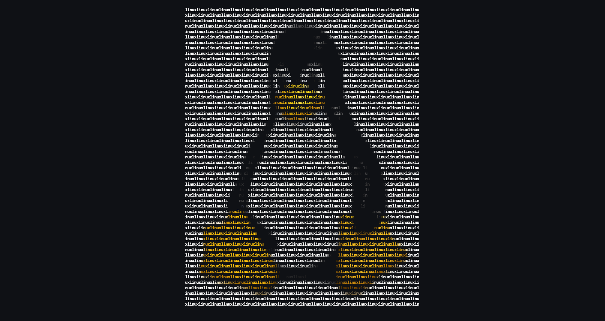

# textimage

Render an image in your terminal as a calligram: every pixel is replaced
with the next character from a text file, colored with the pixel's color.



> **Status:** early version. It works, but has known limitations (see below).

## Build

Requires [Rust](https://rustup.rs) (stable).

```bash
git clone https://github.com/fitng/textimage
cd textimage
cargo run --release -- --image test/picture.jpg --text test/text.txt
```

## Usage

```
textimage --image <FILE> --text <FILE>
```

| Option | Description |
|---|---|
| `-i, --image` | Path to the image (PNG, JPEG, WebP, ...) |
| `-t, --text`  | Path to the text file the characters are taken from |

Press `q` or `Esc` to quit. The picture is redrawn when the terminal is resized.

## How it works

The image is resized to fit the terminal, compensating for the aspect ratio
of a character cell. Each visible pixel is then replaced by the next
character of the text (whitespace is collapsed, and the text loops if it is
shorter than the image) and printed in the pixel's color. Transparent pixels
are left empty; for images without an alpha channel, very dark pixels are
treated as background.

## Limitations

- Requires a terminal with truecolor (24-bit) support.
- The character cell aspect ratio (`0.45`) is hardcoded and may not match your font.
- Wide characters (CJK, emoji) can break the alignment.
- Opaque images with a light background get filled completely.
## License

MIT
